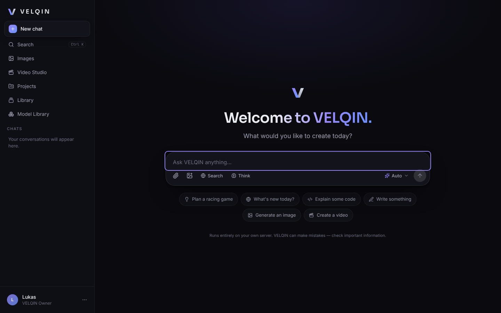

# VELQIN AI — *Create Without Limits*

Private, selbst gehostete KI-Plattform für dich und bis zu ~20 Freunde. Alles läuft **lokal auf deinem PC**
(RTX 4060 / 8 GB VRAM / 16 GB RAM) — keine Cloud-Inferenz, keine API-Kosten, keine Abos, keine Credits.

| Bereich | Was es kann | Technik |
|---|---|---|
| **Chat** | Token-Streaming, Stop, Regenerieren, Bearbeiten, Kopieren, Markdown, Code-Highlighting, Tabellen, LaTeX, Auto-Titel, Suche, Wiederaufnahme nach Verbindungsabbruch | Ollama (Qwen3 4B/8B, Qwen3-VL 4B, Qwen2.5-Coder 7B) |
| **VELQIN Auto** | wählt pro Nachricht Swift / Core / Code / Vision | Heuristik + installierte Modelle |
| **Websuche** | echte Suche, Seiten lesen, Quellen [1] mit URL + Datum, sichtbar getrennt von Modellwissen | SearXNG (self-hosted) + SSRF-geschützter Abruf |
| **Dateien** | PDF, DOCX, TXT, MD, CSV, Code, PNG/JPG/WEBP | pypdf, python-docx, Vision-Modell |
| **Projekte** | Chats, Dateien, Bilder, Videos, eigene Anweisungen, lokales RAG | Ollama-Embeddings (nomic-embed-text) |
| **Image Studio** | Text→Bild, Remix (Bild→Bild, Stil, Variationen), Inpaint (Hintergrund ändern), Outpaint, Upscale ×2, 7 Formate, Seeds, Stile, Live-Vorschau, Warteschlange | ComfyUI + SDXL-Lightning / FLUX.1-schnell GGUF / Real-ESRGAN |
| **VELQIN Motion** | Text→Video, Bild→Video, Video verlängern, 5/10/15/30 s (Segmente), 16:9/9:16/1:1, 24/16 fps, MP4 | ComfyUI + Wan 2.2 TI2V 5B + FFmpeg |
| **GPU-Manager** | exklusive GPU für Bild/Video, entlädt Chatmodelle, Chat weicht auf CPU aus, OOM-Retry, faire Warteschlange | NVML, Ollama keep_alive, ComfyUI /free |
| **Accounts** | Einladungen, Rollen, kostenlose Zugriffsgruppen (Free/Creator/Studio/Owner), Sessions, Profilbild, Daten löschen | Argon2id, HttpOnly-Cookies, CSRF-Schutz |
| **Admin** | Nutzer, Einladungen, Jobs, GPU/VRAM/RAM/CPU/Disk, Dienste, Logs, Einstellungen, Backups — **ohne** fremde Chatinhalte | |
| **Extras** | Spracheingabe (lokales Whisper), Vorlesen, Memory, globale Suche (Strg+K), Dark/Light/System + Akzentfarben, PWA | faster-whisper |



## Schnellstart (Windows)

```powershell
# 1. Ordner VELQIN-AI auf den PC kopieren / klonen, dann in PowerShell darin:
powershell -ExecutionPolicy Bypass -File scripts\install-windows.ps1 -PullModel
# 2. Optional: Bild- & Videoengine (ComfyUI + Modelle)
powershell -ExecutionPolicy Bypass -File scripts\install-comfyui.ps1
# 3. Starten
start-velqin.bat
```

Dann `http://localhost:8080` öffnen → Owner-Konto anlegen → in der **Model Library** VELQIN Swift laden → loschatten.
Handy/iPad im selben WLAN: die Adresse, die `start-velqin.bat` anzeigt (z. B. `http://192.168.178.20:8080`).

Echte Ausführung prüfen (Chat, Bild, Video auf deiner GPU):

```powershell
.venv\Scripts\python.exe scripts\selftest.py --image --video
```

Details: **[docs/INSTALL_WINDOWS.md](docs/INSTALL_WINDOWS.md)** · Bild/Video: **[docs/IMAGE_VIDEO_SETUP.md](docs/IMAGE_VIDEO_SETUP.md)** ·
Fernzugriff: **[docs/REMOTE_ACCESS.md](docs/REMOTE_ACCESS.md)** · Sicherheit: **[docs/SECURITY.md](docs/SECURITY.md)** ·
Architektur: **[docs/ARCHITECTURE.md](docs/ARCHITECTURE.md)** · **Teststatus & Grenzen: [docs/STATUS.md](docs/STATUS.md)**

## Projektstruktur

```
VELQIN-AI/
├── start-velqin.bat          Ein-Klick-Start (Windows)
├── backend/                  FastAPI (Python)
│   ├── api/                  REST + SSE Endpunkte
│   ├── auth/                 Argon2, Sessions, Rate-Limits, Rechte
│   ├── core/  database/  models/
│   ├── services/             Chat-Engine, Ollama, ComfyUI, Websuche, RAG, Dokumente, Medien, Backups
│   ├── gpu_manager/          VRAM-Koordination & Statistiken
│   ├── jobs/                 persistente, faire GPU-Warteschlange
│   └── security/             CSRF, Header, SSRF-Schutz, Dateiprüfung, Moderation
├── frontend/                 Next.js 15 + React 19 + Tailwind 4 + Motion (statischer Export)
│   ├── app/ components/ hooks/ lib/ styles/ public/
├── ai/
│   ├── comfyui/              models.json (Downloads), Dockerfile
│   ├── ollama/  video/       Hinweise zu Modellen & Video-Adaptern
│   └── workflows/            exportierte ComfyUI-Workflows (API-Format)
├── scripts/                  Installer, Starter, Modell-Downloader, Selbsttest, Backup-Restore
├── searxng/settings.yml      Konfiguration der privaten Suchmaschine
├── tests/                    pytest (API, Sicherheit, Workflows)
├── docs/                     Anleitungen, Screenshots
├── storage/                  Datenbank, Uploads, Medien, Logs, Backups (nicht im Git)
├── .env.example  compose.yaml  Dockerfile
```

## Entwicklung

```bash
# Backend
python -m venv .venv && .venv/bin/pip install -r backend/requirements-dev.txt
cd backend && VELQIN_ENVIRONMENT=development ../.venv/bin/python run.py     # :8080, API-Docs unter /api/docs
# Frontend mit Hot-Reload (proxyt /api → :8080)
cd frontend && npm install && npm run dev                                    # :3000
# Tests
.venv/bin/python -m pytest -q tests
```

## Lizenzen

VELQIN-Code: eigener Code dieses Projekts. Verwendete Komponenten: FastAPI (MIT), Next.js (MIT), React (MIT),
Tailwind (MIT), Motion (MIT), lucide (ISC), Ollama (MIT), ComfyUI (GPL-3.0, läuft als separater Prozess),
SearXNG (AGPL-3.0, separater Dienst), FFmpeg (LGPL/GPL, externes Programm). Modelle: Qwen3 / Qwen3-VL /
Qwen2.5-Coder-7B (Apache-2.0), nomic-embed-text (Apache-2.0), SDXL (CreativeML Open RAIL++-M),
SDXL-Lightning (OpenRAIL++), FLUX.1-schnell (Apache-2.0), Wan 2.2 (Apache-2.0), Real-ESRGAN (BSD-3).
Prüfe die Modelllizenzen selbst, bevor du Ergebnisse kommerziell nutzt.
